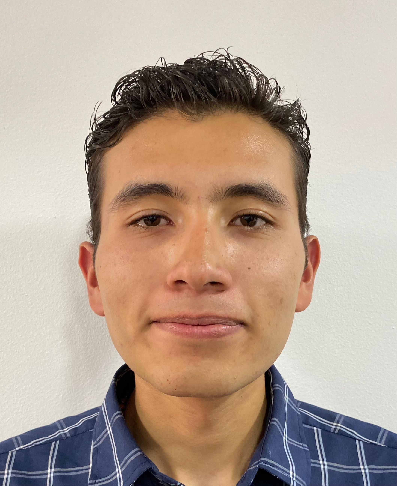

<h1>Servicio - Delorian</h1>

 
                                                                                                                                          
## Documentación

- [Estructura del workspace ROS 2, tópicos y cómo lanzar la simulación](docs/estructura.md)

---

## Descripción                                                                                                                                   
Delorian (Robot agrícola motorizado) es un servicio diseñado para apoyar a un estudiante de maestría en biosistemas en el desarrollo y validaciónsu tesis, en la que se quieren explorar algoritmos de planienarios agrícolas. Para ello, surge la necesidad de contarcon un vehículo móvil autónomo que permita probar en campo algoritmos de navegación, evasión de obstáculos y telemetría en condiciones reales de polvo, humedad y vegetación.

Los objetivos del servicio se enfocan en entregar un vehícuue opere tanto en modo teleoperado como en modo autónomo,proveer canal de telemetría en tiempo real de variables críticas (pose, sensores, energía y estado del sistema) y facilitar un entorno experimental
para validar y comparar algoritmos de planificación de moviporte técnico en mecánica, electrónica y software; asegurarestabilidad y seguridad en campo; y generar documentación, protocolos de prueba y datos experimentales que el estudiante pueda usar directamente en
su investigación. El servicio está pensado para satisfacer ocidades de trabajo bajas y controladas, sensoresobligatorios para navegación y protección mínima contra polvo y salpicaduras.

El alcance abarca diseño e integración del sistema mecatrónico, control, instrumentación e interfaz de usuario. Así como la puesta a punto para
pruebas en laboratorio y campo, junto con acompañamiento enlmente, se contempla la posibilidad de incorporar a futuro un manipulador robótico en la plataforma para aplicaciones de recolección.

---

### Duvan AAA

   

- **Carrera:** Ingeniería Mecatrónica
- **Correo institucional:** AAA
- **Usuario de GitHub:** AAA
- **Rol en el equipo:** AAA
- **Intereses:** AAA
- **Descripción breve:**
AAA

---

### Jesús David Sánchez Cobos

   

- **Carrera:** Ingeniería Mecatrónica
- **Correo institucional:** jesanchezco@unal.edu.co
- **Usuario de GitHub:** [Kovoz](https://github.com/Kovoz)
- **Rol en el equipo:** Modelado, redacción y edición de vi
- **Intereses:** Estudiante interesado en el diseño de sistemas mecatrónicos y la robótica de servicio, con especial motivación en la robótica
bioinspirada.
- **Descripción breve:**
Me considero una persona con actitud positiva, dedicada y tor mi atención a los detalles y mi compromiso para darsiempre lo mejor en cualquier proyecto o entorno. Poseo habilidades de liderazgo y trabajo en equipo, y me apasionan las matemáticas, la física, el
diseño y la programación.

---

### Jesús Manuel Aragón Buitrago

  

- **Carrera:** Ingeniería Mecatrónica
- **Correo institucional:** jaragonb@unal.edu.co
- **Usuario de GitHub:** AAA
- **Rol en el equipo:** AAA
- **Intereses:** AAA
- **Descripción breve:**
AAA

---

### Juan Andrés Mora Henao

   

- **Carrera:** Ingeniería Electrónica
- **Correo institucional:** AAA
- **Usuario de GitHub:** AAA
- **Rol en el equipo:** AAA
- **Intereses:** AAA
- **Descripción breve:**
AAA

---

### Juan Andrés Moreno Benavides

  

- **Carrera:** Ingeniería Mecatrónica
- **Correo institucional:** AAA
- **Usuario de GitHub:** AAA
- **Rol en el equipo:** AAA
- **Intereses:** AAA
- **Descripción breve:**
AAA

---

### Paola Alejandra Bello Buitrago

  

- **Carrera:** Ingeniería Electrónica
- **Correo institucional:** AAA
- **Usuario de GitHub:** AAA
- **Rol en el equipo:** AAA
- **Intereses:** AAA
- **Descripción breve:**
AAA

---

